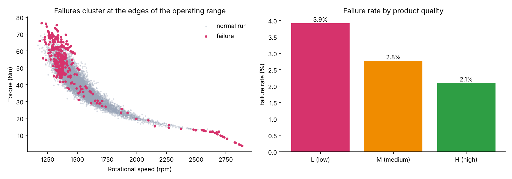
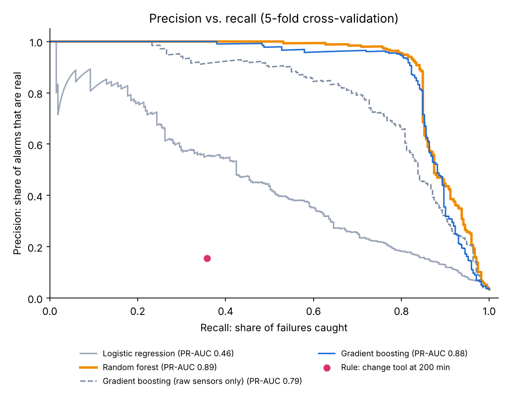
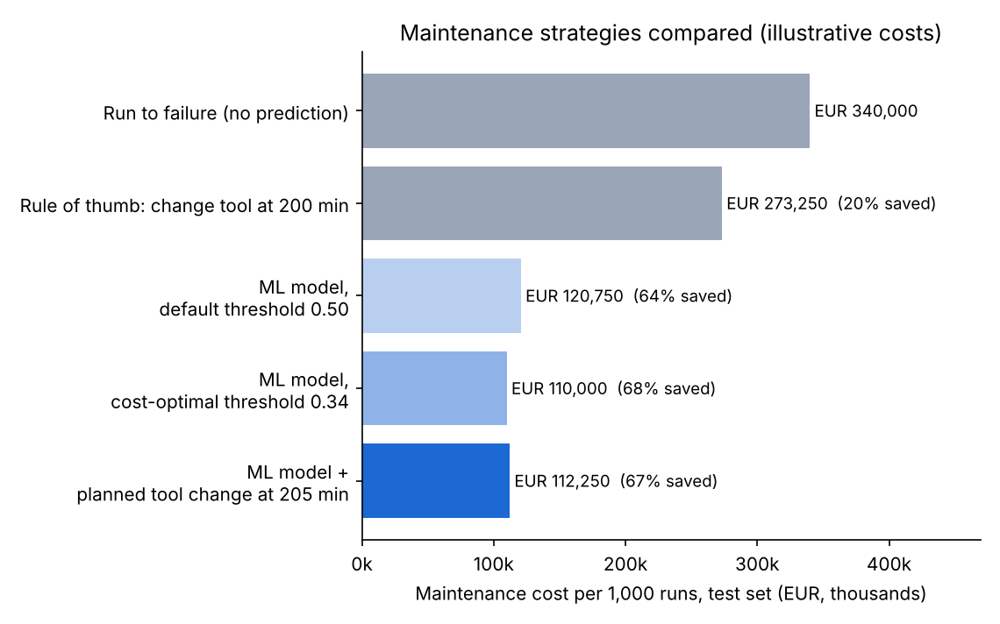
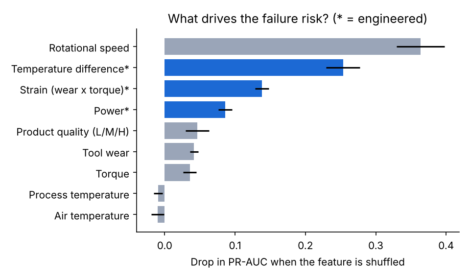
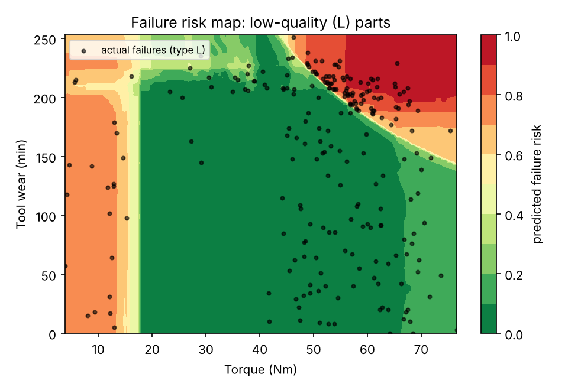
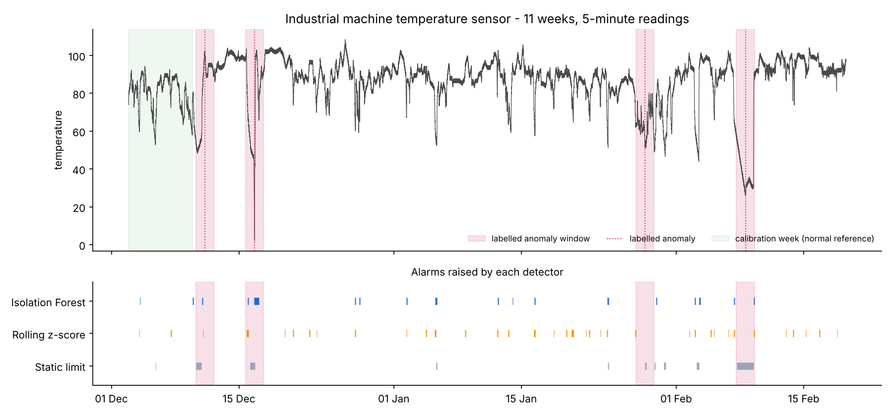
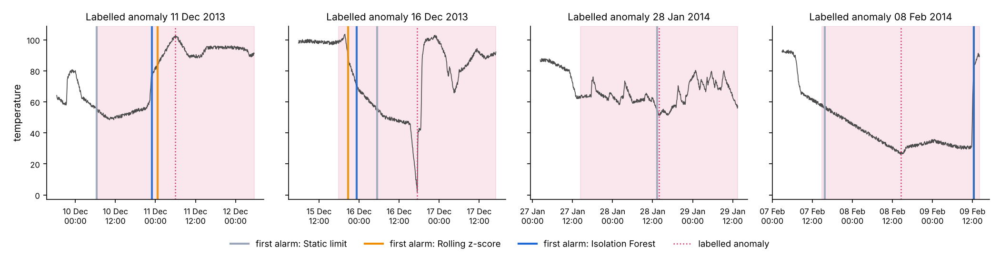

# 🏭 Predictive Maintenance & Industrial Anomaly Detection

**Business question:** an unplanned machine breakdown stops the production line. Can sensor data tell us *which* runs are about to fail, and *how early* a developing problem becomes visible, so that maintenance can be planned instead of reactive?

The project answers this in two parts:

1. **Failure prediction** (supervised ML): which machining runs will fail? Trained on **10,000 milling-machine runs** with five labelled failure types, with the alarm threshold chosen by a **maintenance cost model**.
2. **Early warning** (unsupervised anomaly detection): how many hours before a failure does a **real industrial machine's temperature sensor** show trouble? Three detectors are compared, without using failure labels to build them.

📓 **The full analysis reads like a report in [`notebooks/walkthrough.ipynb`](notebooks/walkthrough.ipynb).**

---

## Headline results

| | Result |
|---|---|
| Failures caught (test set, 2,000 unseen runs) | **58 of 68 (85%)** with only **8 false alarms** |
| With a planned tool change at 205 min | **64 of 68 (94%)** caught, 113 extra inspections |
| Maintenance cost vs. running to failure | **−68%** (illustrative costs; simple tool-change rule: −20%) |
| Heat, power & overstrain failures | **100%** caught |
| Early warning on the real machine | **4 of 4** labelled events, median **17 hours** ahead, 0.5 false alarms per week |

---

## Part 1: Failure prediction (AI4I 2020)



Failures cluster at the **edges of the operating range**: very high torque at low speed (overstrain, too much power) and very low torque at high speed (too little power). Low-quality (L) parts fail almost twice as often as high-quality ones (3.9% vs. 2.1%). So I added three **physics-based features**: spindle **power** (torque × angular speed), **strain** (tool wear × torque) and the **temperature difference** between process and air, which signals heat-dissipation problems.

### Model comparison (5-fold cross-validation, 8,000 training runs)

| Model | PR-AUC | ROC-AUC |
|---|---|---|
| Rule of thumb: change tool at 200 min | – | recall 0.36 · precision 0.16 |
| Logistic regression | 0.455 | 0.922 |
| Gradient boosting, **raw sensors only** | 0.792 | 0.967 |
| Gradient boosting, **+ engineered features** | 0.875 | 0.968 |
| **Random forest** (selected) | **0.893** | **0.977** |

<sub>PR-AUC (precision-recall area) is the main metric because failures are rare (3.4%): a model that never raises an alarm would still be 96.6% "accurate".</sub>



### Choosing the alarm threshold by cost

A missed failure, a planned repair and a false alarm cost very different amounts. With illustrative costs in [`configs/costs.yaml`](configs/costs.yaml) (unplanned breakdown €10,000 · planned intervention €2,000 · false alarm €500), the threshold that minimises expected cost on the training data is **0.34**, not the default 0.50.

| Strategy (test set, 2,000 runs) | Caught | Missed | False alarms | Cost per 1,000 runs | Saving |
|---|---|---|---|---|---|
| Run to failure (no prediction) | 0 | 68 | 0 | €340,000 | – |
| Rule of thumb: change tool at 200 min | 26 | 42 | 149 | €273,250 | 20% |
| ML model, default threshold 0.50 | 55 | 13 | 3 | €120,750 | 64% |
| **ML model, cost-optimal threshold 0.34** | **58** | **10** | **8** | **€110,000** | **68%** |
| ML model + planned tool change at 205 min | 64 | 4 | 113 | €112,250 | 67% |



### Key observations

- **Domain knowledge beat model choice.** The engineered features lifted the same gradient-boosting model from 0.79 to 0.88 PR-AUC. Rotational speed, temperature difference, strain and power are the strongest risk drivers.
- **Physics-driven failures are fully predictable.** All heat-dissipation (29/29), power (13/13) and overstrain (16/16) failures in the test set were caught.
- **Tool-wear failures are not.** They happen at a random point between about 200 and 240 minutes of use, so the sensors can't see them coming (only 2/10 caught). A planned tool change at 205 minutes, with the limit chosen on training data, raises this to 7/10 and overall recall to 94%.
- **The best strategy is a business decision.** On the test set both strategies cost about the same. The planned tool change trades 105 extra inspections for 6 fewer breakdowns, which **pays off once an unplanned breakdown costs more than about €10,750**:

| Cost of one unplanned breakdown | Model only | Model + tool change | Cheaper |
|---|---|---|---|
| €5,000 | €170,000 | €204,500 | Model only |
| €10,000 | €220,000 | €224,500 | Model only |
| €20,000 | €320,000 | €264,500 | **Model + tool change** |
| €50,000 | €620,000 | €384,500 | **Model + tool change** |

| What drives the risk? | Where do failures happen? |
|---|---|
|  |  |

<sub>Right: predicted risk for low-quality (L) parts across torque and tool wear. The diagonal edge is the overstrain limit (wear × torque), and the band on the left is power failure at low torque.</sub>

---

## Part 2: Early warning from a temperature sensor (NAB)

A temperature sensor on an internal component of a **real industrial machine**: 11 weeks of 5-minute readings (22,683 after cleaning), with **four labelled anomalies**. Numenta's description of this machine mentions a planned shutdown and a hard-to-detect anomaly that led directly to a catastrophic failure.

The detectors are built **without failure labels**, as for a new machine with no failure history. They only see past readings, and their settings follow standard rules of thumb (1st percentile, 3 standard deviations, 30 minutes persistence) instead of being tuned to the four events. The labels are used only for scoring.

| Detector | Events detected | Median warning before event | False alarms |
|---|---|---|---|
| **Static low-temperature limit** (1st percentile of a normal week) | **4 / 4** | **17.4 h** | **0.5 per week** (5) |
| Rolling z-score (> 3σ vs. last 24 h) | 3 / 4 ¹ | 5.4 h | 3.0 per week (31) |
| Isolation Forest (ML, 6 rolling features) | 3 / 4 ¹ | 7.1 h | 1.3 per week (13) |

<sub>¹ Includes the 8 Feb event, which both flagged only about 22 hours after it happened. Both missed the 28 Jan event.</sub>





### Key observations

- **The simplest detector won.** This machine's problems show up as **sustained temperature drops**, which a well-calibrated fixed limit catches early and reliably.
- **Adaptive detectors "get used to" slow trouble.** On the slow decline before 8 Feb, the rolling z-score and Isolation Forest kept updating their idea of "normal" and only raised an alarm when the machine restarted, about **22 hours after** the labelled anomaly.
- **But they react faster to sudden changes.** On 16 Dec they warned 18–21 hours ahead, versus 12 hours for the static limit. The methods are complementary, and combining them is the natural next step.
- **Lesson: always benchmark ML against the simple rule** and match the detector to how the failure develops.
- **Real data is messy.** The sensor clock jumps back 55 minutes on 7 Jan, repeating 12 timestamps. The loader sorts the readings and averages duplicates.

<sub>Warning times are measured from the first alarm inside NAB's labelled window, which opens about 24 hours before each event, so the maximum measurable warning is about 24 hours.</sub>

---

## Use it: daily maintenance worklist

`predict.py` scores new runs and recommends an action. The output CSV can feed an Excel or Power BI maintenance dashboard.

```
$ python src/predict.py --input samples/new_runs.csv

product_id  type  speed_rpm  torque_nm  tool_wear_min  failure_risk  recommended_action
    L54191     L       2633       12.2             17         0.994  STOP & INSPECT - high failure risk
    L51841     L       1350       48.1             32         0.987  STOP & INSPECT - high failure risk
    L53258     L       1339       59.1            203         0.976  STOP & INSPECT - high failure risk
    M22885     M       1422       50.7            219         0.193  PLAN TOOL CHANGE - tool wear >= 205 min
    L52571     L       1572       34.4            228         0.132  PLAN TOOL CHANGE - tool wear >= 205 min
    L53382     L       1296       54.9             69         0.009  OK
    ...
5 of 12 runs need attention.
```

<sub>The sample rows come from the AI4I dataset, which the shipped model was trained on, so this shows how the tool works, not its accuracy. Accuracy is measured on the held-out test set above.</sub>

---

## Project structure

```
predictive-maintenance/
├── configs/costs.yaml              # maintenance cost assumptions (edit to your plant's numbers)
├── src/
│   ├── data.py                     # downloads both datasets, cleaning, physics-based features
│   ├── failure_prediction.py       # Part 1: model comparison, cost threshold, test evaluation, charts
│   ├── anomaly_detection.py        # Part 2: three detectors, warning times, false alarms, charts
│   └── predict.py                  # score new runs → maintenance worklist CSV
├── notebooks/walkthrough.ipynb     # the full analysis with explanations (executed)
├── models/                         # trained model + model card (threshold, costs, test scores)
├── results/                        # every table as CSV (Excel / Power BI ready)
├── assets/                         # charts used in this README
└── samples/new_runs.csv            # example input for predict.py
```

## Quick start

```bash
pip install -r requirements.txt
python src/failure_prediction.py     # Part 1 (downloads data on first run, ~1 minute)
python src/anomaly_detection.py      # Part 2 (~10 seconds)
python src/predict.py                # score new runs with the trained model
```

To test other cost assumptions, edit `configs/costs.yaml` and rerun `failure_prediction.py`. The threshold, savings and break-even point are recalculated.

---

## Limitations & next steps

- **Costs are illustrative.** Real figures (cost of a line stop per minute, scrap, technician time) would change the threshold and the tool-change decision. The break-even analysis shows how sensitive the choice is.
- **AI4I is synthetic.** It is generated to mirror a real milling process, which is why physics-driven failures are so predictable. Real plant data will be noisier.
- **A single sensor with four labelled events** is a small basis for comparing detectors. More machines and failures are needed before rolling out to a plant.
- **Next:** combine the static limit with an adaptive detector, add remaining-useful-life prediction (for example NASA's C-MAPSS turbofan data), and build a Power BI dashboard on the worklist CSV.

---

## Tech stack

Python · scikit-learn (Random Forest, Gradient Boosting, Isolation Forest) · pandas · NumPy · matplotlib · Jupyter

## Credits & licences

- **AI4I 2020 Predictive Maintenance Dataset:** S. Matzka (2020), UCI Machine Learning Repository, CC BY 4.0. Downloaded from a GitHub mirror, verified against the published statistics (10,000 runs, 339 failures)
- **Numenta Anomaly Benchmark (NAB):** machine_temperature_system_failure, A. Lavin & S. Ahmad (2015), [github.com/numenta/NAB](https://github.com/numenta/NAB), MIT licence
- Project idea from [project-based-learning](https://github.com/practical-tutorials/project-based-learning)

Code released under the MIT licence. Raw data is downloaded at runtime and not stored in this repository.

**Author:** Souad Essemyhij, MSc Robotics and Autonomous Systems, Universität zu Lübeck · [LinkedIn](https://www.linkedin.com/in/souad-essemyhi-742a9520b/) · [GitHub](https://github.com/souadessemyhij1999)
